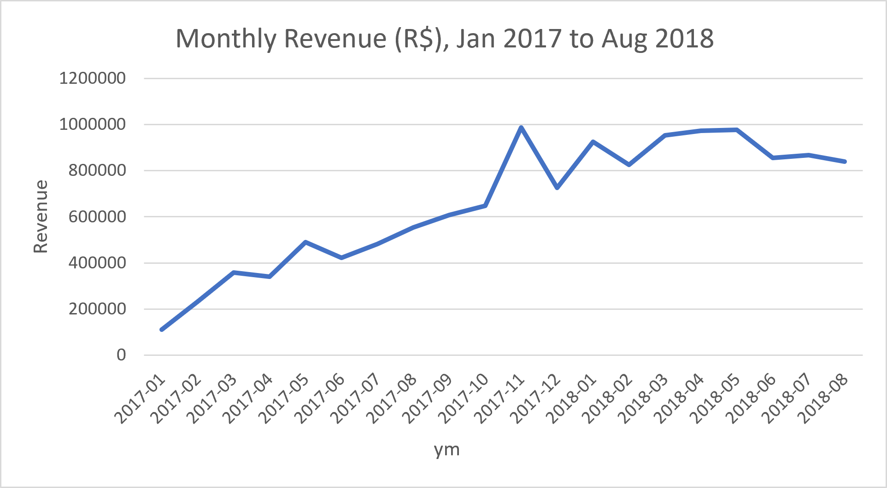
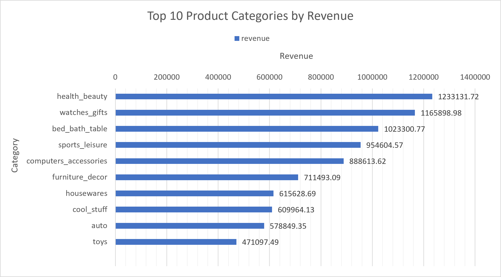
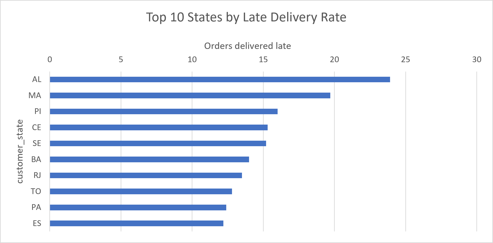

# Olist E-commerce Sales Analysis (SQL)

Analysis of 96K+ delivered orders from a Brazilian online marketplace, using MySQL to find out what drives revenue, who the customers are, and where delivery falls short.

**Tools:** MySQL 8.0, MySQL Workbench | **Techniques:** joins, CTEs, window functions (LAG, RANK, NTILE, running totals), data validation

---

## Business Problem

A marketplace like Olist wants to answer practical questions:

- How is revenue growing, and when does it peak?
- Which product categories and states matter most?
- Do customers come back, and how concentrated is spending?
- Where is delivery slow or unreliable?
- How do customers pay, and which sellers lead each state?

This project answers these with SQL and ends with recommendations.

## Dataset

- **Source:** [Brazilian E-Commerce Public Dataset by Olist](https://www.kaggle.com/datasets/olistbr/brazilian-ecommerce) (Kaggle)
- **Period covered:** September 2016 to August 2018 (trend analysis uses Jan 2017 to Aug 2018)
- **Currency:** Brazilian reais (R$)
- **Tables used (8):** `customers`, `orders`, `order_items`, `order_payments`, `order_reviews`, `products`, `sellers`, `category_translation`

How the tables connect:

- `orders` links to `customers` through `customer_id`
- `order_items` links to `orders` through `order_id`, to `products` through `product_id`, and to `sellers` through `seller_id`
- `order_payments` links to `orders` through `order_id`
- `products` links to `category_translation` through `product_category_name`

Note that `customer_id` is unique per order, so repeat-customer analysis uses `customer_unique_id`.

## Data Cleaning and Assumptions

| Decision | Reason |
|---|---|
| Only `delivered` orders are analyzed (96,455 orders) | Completed sales give the most reliable revenue figures |
| Revenue = `SUM(price)` from `order_items` | Excludes freight; payment analysis (Q9) uses `payment_value`, which includes freight |
| 2,470 order items had no matching loaded order | Excluded automatically by joining through `orders` |
| No duplicate order IDs were found | Checked with `GROUP BY ... HAVING COUNT(*) > 1` |
| Every loaded order has at least one item | Checked with a `LEFT JOIN` |
| Trend analysis covers Jan 2017 to Aug 2018 | 2016 data is sparse |
| Repeat customers use `customer_unique_id` | `customer_id` changes with every order |
| Review analysis excluded | Review data loaded incompletely (279 rows), so no review-based conclusions are drawn |

**Load limitations:** Data was loaded with the MySQL Import Wizard, which skipped rows it could not parse. 96,461 of 99,441 orders and 32,340 of 32,951 products loaded; the missing orders mostly had blank date fields. Because the analysis is limited to delivered orders, the effect on revenue figures is small, but exact totals may differ slightly from the full dataset.

## Key Results

| Metric | Value |
|---|---|
| Delivered orders | 96,455 |
| Unique customers | 93,336 |
| Revenue (item price) | R$13.22M |
| Average order value | R$137.04 |
| Average delivery time | 12.5 days |
| Orders delivered late | 8.1% |
| Customers who bought only once | 97.0% |

## Analysis

All queries are in [`sql/03_business_analysis.sql`](sql/03_business_analysis.sql).

### Q1. What are the overall headline numbers?
96,455 delivered orders from 93,336 unique customers generated R$13.22M in revenue, with an average order value of R$137.04. Orders are only about 3% higher than customers, which hints at very low repeat buying (confirmed in Q5).

### Q2. How does monthly revenue trend?
- Revenue grew from R$112K in January 2017 to a peak of R$988K in November 2017 (+52% over October, Black Friday).
- December 2017 dropped 26.5%, and revenue then plateaued between about R$830K and R$980K per month through 2018 (R$839K in August 2018).
- The February 2017 jump (+108%) comes from a very small base.



### Q3. Which product categories drive revenue?
- Revenue is spread across many categories rather than following a strict 80/20 pattern.
- The top 5 categories (health_beauty, watches_gifts, bed_bath_table, sports_leisure, computers_accessories) generate 40.4% of category revenue, and the top 10 generate 63.3%.
- It takes about 14 categories to reach 80% of revenue.
- health_beauty leads with R$1.23M (9.5%), followed by watches_gifts at R$1.17M (8.9%).
- Many categories contribute less than 1% each, forming a long tail.



### Q4. Which states bring the most revenue?
- Sao Paulo (SP) dominates with R$5.07M (38.3% of revenue) and 40,488 orders (42.0% of orders).
- SP, RJ, and MG together bring R$8.38M, about 63% of total revenue.
- Southeastern Brazil is the core market.

### Q5. How many customers come back?
- Only 2,800 of 93,336 customers (3.0%) ordered more than once; 90,536 customers (97.0%) bought exactly once.
- Only 181 customers ordered three times.
- Revenue comes almost entirely from new customers, so retention is the biggest weakness.

### Q6. How concentrated is spending across customers?
- The top 25% of customers (average spend R$354) generate R$8.27M, which is 62.5% of revenue; the top 50% generate 83.3%.
- The bottom quartile averages R$29 per customer and contributes 5.1% of revenue.

### Q7. How fast is delivery, and how often is it late?
Across 96,455 delivered orders, the average delivery time is 12.5 days and 8.1% of orders arrive after the estimated date.

### Q8. How does delivery performance vary by state?
- Alagoas (AL) has the highest late rate (23.9%) and the second-slowest delivery (24.5 days), followed by Maranhao (MA, 19.7%) and Piaui (PI, 16.0%).
- Sao Paulo is the fastest and most reliable (8.7 days, 5.9% late).
- Rio de Janeiro stands out: 12,348 orders with a 13.5% late rate, the largest late-delivery impact among big markets.
- Amazonas (AM) has the longest delivery time (26.4 days) but only 4.1% late, because estimated dates there are longer, so slow does not always mean late.



### Q9. How do customers pay?
- Credit card dominates: 74,296 orders (77% of delivered orders) and R$12.10M in payments (78.5% of total payment value), with 3.5 installments on average.
- Boleto (bank slip) is second with 19,177 orders and R$2.77M; voucher and debit card are minor.
- Order counts add up to more than 96,455 because some orders use more than one payment type, and payment value includes freight.

### Q10. Who are the top 3 sellers in each state?
- Seller revenue is concentrated in a few large sellers. The top Sao Paulo seller earned R$227K, and the top 3 SP sellers each earned over R$190K.
- A Bahia seller earned R$218K even though Bahia is a small buyer market, suggesting nationwide selling.
- Other state leaders: RJ R$123K, MG R$99K, PR R$73K, SC R$59K.
- In many smaller states (for example PA, PI, RO, SE) even the best seller earned under R$5K.
- `seller_state` is where the seller is located, not where customers are.

### Q11. What is the running total of revenue?
- Cumulative revenue reached R$13.18M by August 2018.
- The first 8 months of 2018 (R$7.22M) exceeded all of 2017 (R$5.96M) by about 21%.
- Validation: the Q1 total (R$13.22M) minus this cumulative total leaves about R$40K, which is the revenue from the excluded 2016 period.

## Insights and Recommendations

1. **Improve customer retention.** 97% of customers buy only once. Follow-up emails, loyalty offers, and re-engagement campaigns could add revenue without finding new customers.
2. **Protect high-value customers.** The top 25% of customers drive 62.5% of revenue. Target them with premium offers and priority service.
3. **Fix delivery in the Northeast and Rio de Janeiro.** AL, MA, PI, and RJ have the highest late rates. Better logistics partners and more accurate delivery estimates would help.
4. **Plan for seasonality.** Revenue peaks in November (Black Friday) and dips in December; inventory and marketing should follow this pattern.
5. **Grow beyond the Southeast.** SP, RJ, and MG generate 63% of revenue, so other regions are underdeveloped markets.
6. **Support the leading categories.** health_beauty, watches_gifts, and bed_bath_table lead, but a long tail of small categories could be reviewed for focus.

## Repository Structure

```
olist-ecommerce-sql-analysis/
├── README.md
├── sql/
│   ├── 01_schema_and_load.sql      # database, tables, data import
│   ├── 02_data_quality.sql         # validation checks
│   └── 03_business_analysis.sql    # Q1-Q11 with findings
└── images/                         # charts used in this README
```

## How to Run

1. Install MySQL 8.0+ and MySQL Workbench.
2. Download the dataset from Kaggle and unzip it.
3. Run `sql/01_schema_and_load.sql` to create the database and tables, then import the CSV files.
4. Run `sql/02_data_quality.sql` to verify the data.
5. Run `sql/03_business_analysis.sql` to reproduce the analysis.

## Limitations

- Some rows were skipped during import, so totals may differ slightly from the full dataset.
- Review data was incomplete and was not analyzed.
- Revenue uses item price only and excludes freight.
- The dataset ends in August 2018, so conclusions describe that period only.

## Author

**Chirag Vohra**
[LinkedIn](https://www.linkedin.com/in/chirag-vohra-4ba3793b2/) | [GitHub](https://github.com/Cv-cyber) | chiragdvohra@gmail.com
